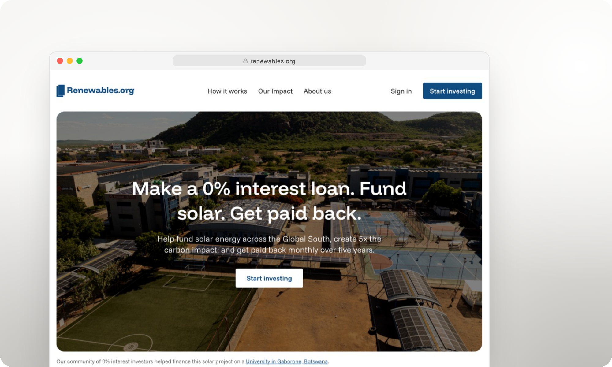

### Hi, I'm Lassor

I turn complex ideas into simple products, handling everything from brand and UI/UX to production code.

By day I build the investing platform at [Renewables.org](https://renewables.org). On the side I ship ambitious products end to end. A few are pinned below.

**Portfolio:** [lassor.com](https://www.lassor.com)

<table>
  <tr>
    <td colspan="2"> <b>Renewables.org</b>: 0% interest loans that fund solar across the Global South</td>
  </tr>
  <tr>
    <td width="50%"> <b>Swiper</b>: workout logging for iPhone and Apple Watch</td>
    <td width="50%"> <b>Gracious</b>: a booking calendar for your guest rooms</td>
  </tr>
  <tr>
    <td width="50%"> <b>Seatback Safety</b>: an archive of 300+ airline safety cards</td>
    <td width="50%"> <b>Walking Forward</b>: travel told through walking panoramas</td>
  </tr>
</table>
